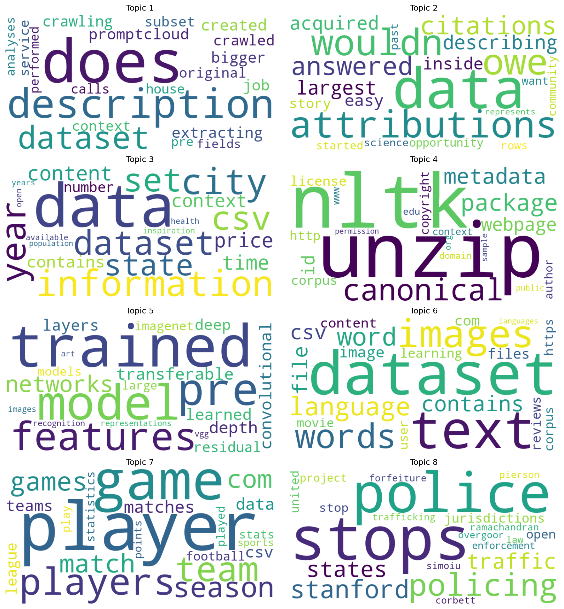

# Topic Modeling on Kaggle Dataset Descriptions

 

Discovers the main themes in the text descriptions of popular (voted) Kaggle datasets. Two unsupervised topic models are applied and compared:

- **LDA (Latent Dirichlet Allocation)**: probabilistic model built with Gensim and explored interactively with pyLDAvis
- **NMF (Non-negative Matrix Factorization)**: matrix factorization on TF-IDF features, visualized with word clouds

## Results

After running the script, the results are saved in the repo:

| Output | Description |
|---|---|
| [`outputs/topics_summary.md`](outputs/topics_summary.md) | Top words for every LDA and NMF topic, plus the LDA coherence score |
| [`outputs/lda_visualization.html`](outputs/lda_visualization.html) | Interactive intertopic distance map ([live demo](https://ashfanbelim.github.io/Topic-Modeling/outputs/lda_visualization.html)) |
| [`images/`](images/) | One word cloud per NMF topic, plus an overview image |



## Dataset

`data/voted-kaggle-dataset.csv` contains Kaggle datasets with a `Description` column, which is the text used for modeling.

Source: [Kaggle](https://www.kaggle.com/datasets). Check the dataset page for its license before reusing the data.

## Methodology

1. **Data loading**: read the CSV with pandas.
2. **Cleaning**: drop missing, empty and whitespace-only descriptions.
3. **Preprocessing**
   - Lowercase and tokenize with Gensim `simple_preprocess` (accents removed, tokens under 2 characters dropped)
   - Remove stop words (scikit-learn's English list plus custom words such as *using, use, used, also, new, like*)
   - Drop documents that become empty
4. **LDA**
   - Build a Gensim `Dictionary` and filter extremes (words in fewer than 2 documents or more than 90% of documents)
   - Train `LdaModel` with 5 topics (10 passes, 100 iterations, `random_state=42`)
   - Compute the c_v coherence score
   - Visualize with pyLDAvis (metric MDS) and export to HTML
5. **NMF**
   - Build a TF-IDF matrix (max 5,000 features)
   - Factorize with `NMF` (8 topics, 400 iterations, `random_state=42`)
   - Extract the top 10 words per topic and draw a word cloud of the top 20

The topic counts differ (LDA 5, NMF 8) and can be changed with command-line options. For a fair comparison, run both with the same number.

## Getting started

**Requirements:** Python 3.9 to 3.11 (the pinned library versions are not guaranteed to work on newer Python).

```bash
git clone https://github.com/AshfanBelim/Topic-Modeling.git
cd Topic-Modeling
python -m venv .venv
.venv\Scripts\activate           # Windows
source .venv/bin/activate        # macOS / Linux
pip install -r requirements.txt
python topic_modeling.py
```

### Options

```bash
python topic_modeling.py --lda-topics 6 --nmf-topics 6
python topic_modeling.py --data path/to/file.csv --text-column Description
```

| Option | Default | Description |
|---|---|---|
| `--data` | `data/voted-kaggle-dataset.csv` | Path to the CSV file |
| `--text-column` | `Description` | Column containing the text |
| `--lda-topics` | `5` | Number of LDA topics |
| `--nmf-topics` | `8` | Number of NMF topics |
| `--top-words` | `10` | Words listed per topic |
| `--cloud-words` | `20` | Words drawn in each word cloud |

## Project structure

```
.
├── topic_modeling.py     # Full pipeline (LDA + NMF)
├── requirements.txt
├── data/
│   └── voted-kaggle-dataset.csv
├── outputs/              # LDA visualization and topic summary
├── images/               # NMF word clouds
├── LICENSE
└── README.md
```

## Tech stack

Python, pandas, Gensim, scikit-learn, pyLDAvis, matplotlib, WordCloud

## Future improvements

- Choose the number of topics using coherence scores
- Add lemmatization and bigrams
- Label topics manually and compare LDA vs NMF quantitatively

## Author

Ashfan Belim, [GitHub](https://github.com/AshfanBelim)

## License

MIT, see [LICENSE](LICENSE).
